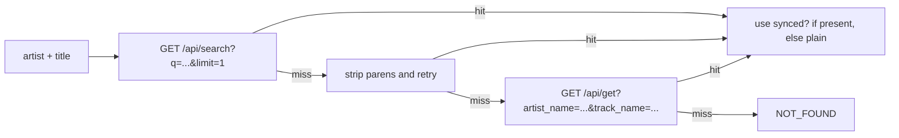

# DeepKick Lyrics — Implementation Plan

> **Status**: v0.1 implemented. See [Implementation Notes](#implementation-notes) at the bottom for what was actually built.

## Goal
Android-only Tauri app that lets a user pick MP3 / FLAC files (and folders) from local storage, fetches synchronized or plain lyrics from `lrclib.net` using each file's `artist` / `title` tags, embeds them into the file metadata (`USLT` for ID3v2, `LYRICS` Vorbis comment for FLAC), shows a final report, and supports manual edit + batch removal of lyrics.

## Stack & Conventions

- **Backend**: Tauri 2 + Rust. Heavy work (file IO, metadata read/write, HTTP fetch) lives in Rust commands.
- **Frontend**: Vanilla TS + Vite, rendered through Tauri WebView. UI primitives via the existing [`rampike`](https://www.npmjs.com/package/rampike) library (already in [`package.json:14`](../package.json:14)), following the conventions established in `references/aegir/`:
  - `src/index.ts` — bootstrap, registers rampike elements, wires units.
  - `src/units/<feature>.ts` — feature modules, each exporting a `featureUnit()` setup function called on `DOMContentLoaded`.
  - `src/components/<thing>.ts` — custom web components built on `mudcrack`.
  - `src/utils.ts`, `src/types.ts` — shared helpers and types.
  - Path aliases mirror aegir's `tsconfig.json`: `@rampike/* → src/components/*`, `@units/* → src/units/*`, `@root/* → src/*`.
- **References used for inspiration**:
  - [`references/slm/`](../references/slm/) — flow, command set, GLR counters, USLT behavior.
  - [`references/aegir/`](../references/aegir/) — rampike usage, unit-based frontend, IDB persistence pattern, toasts.
- **Lyrics source**: `lrclib.net` only (per user choice). Try a few search variants before reporting `NOT_FOUND`.

## High-Level Architecture

```mermaid
flowchart TB
    subgraph UI [Frontend - TS]
        A[index.html] --> B[src/index.ts]
        B --> C[src/units/main.ts]
        B --> D[src/units/picker.ts]
        B --> E[src/units/processing.ts]
        B --> F[src/units/report.ts]
        B --> G[src/units/settings.ts]
        C --> H[src/utils.ts]
        D --> H
        E --> H
        F --> H
        E -.invoke.-> T1
        D -.invoke.-> T2
        F -.invoke.-> T3
    end

    subgraph Rust [Backend - src-tauri/src]
        T1[process_queue cmd] --> P1[Processor]
        T2[scan_files cmd] --> P2[Scanner]
        T3[read/set/clear_lyrics cmd] --> P3[TagIO]
        P1 --> Lyrics[LyricsClient - lrclib]
        P1 --> TagIO
        Scanner --> TagIO
    end

    subgraph Android
        Android[(Storage Access Framework)] --> Scanner
        TagIO --> Android
    end
```

## Rust Backend (Tauri)

All commands live in `src-tauri/src/lib.rs` (or split into modules under `src-tauri/src/` for clarity: `lib.rs`, `tags.rs`, `scanner.rs`, `processor.rs`, `lyrics.rs`).

### Crate dependencies ([`src-tauri/Cargo.toml`](../src-tauri/Cargo.toml:1))
- `id3 = "1"` — read/write ID3v2 tags (`USLT` frames), preserves existing frames.
- `metaflac = "0.2"` — read/write Vorbis comments (`LYRICS` field).
- `walkdir = "2"` — recursive directory enumeration.
- `ureq = "2"` (blocking, no extra deps) — lrclib HTTP calls (lighter than `reqwest`).
- `serde`, `serde_json` — already present.
- `tauri-plugin-dialog = "2"` — file/folder picker.
- `tauri-plugin-notification = "2"` — completion notification.
- `tokio` with `rt-multi-thread` feature (Tauri already pulls it in) — to run the queue without blocking the command thread.

### Commands

| Command | Purpose |
|---|---|
| `pick_files() -> Vec<AudioFile>` | Opens system file dialog (multi-select) for `audio/*`, returns list of `{ uri, name, kind }`. |
| `pick_folders() -> Vec<AudioFile>` | Opens system folder dialog, walks each folder with `walkdir`, collects `*.mp3` / `*.flac`, returns the same struct. |
| `read_metadata(uri) -> Metadata` | Dispatches by extension: ID3v2 (`id3`) or FLAC (`metaflac`); returns `{ artist?, title?, album?, lyrics_present: bool, lyrics_len?: usize }`. |
| `fetch_lyrics(artist, title) -> Result<String, LyricsError>` | lrclib lookup with variants (see below). |
| `set_lyrics(uri, lyrics) -> ()` | Writes USLT (MP3) or LYRICS Vorbis comment (FLAC), preserving other frames/fields. Atomic write via temp-file-then-rename. |
| `clear_lyrics(uri) -> ()` | Removes the same frame/comment; no-op if absent. |
| `process_queue(QueueSpec) -> Report` | Runs `fetch_lyrics` → `set_lyrics` per file, emits progress events, returns aggregated counts. |

### `process_queue` semantics (mirrors SLM [`ProcessorAPI`](../references/slm/src/com/milesseventh/slm_gui/ProcessorAPI.java:25))
- Per-file `Result` enum reused from SLM: `OK | NOT_FOUND | NO_TAG | EXISTING | ERR`.
- Aggregated `Report` (mirrors `glresults` from [`ProcessorAPI.java:46`](../references/slm/src/com/milesseventh/slm_gui/ProcessorAPI.java:46)): `{ ok, not_found, no_tag, existing, errors, total }`.
- Emits `processor://progress` events with `{ index, name, status, lyrics_preview? }` so the UI can update entries live.
- Skips files that already have non-empty lyrics unless `overwrite = true` is passed in `QueueSpec`.
- Run inside `tauri::async_runtime::spawn`; cancellable via shared `AtomicBool` stored in `tauri::State`.

### lrclib lookup strategy ([`references/slm/ProcessorAPI.java:253-296`](../references/slm/src/com/milesseventh/slm_gui/ProcessorAPI.java:253) inspired this order)



Preference order for the returned text: synced LRC > instrumental placeholder detection (skip) > plain lyrics. We store the plain text (without LRC timestamps) by default — `USLT` and `LYRICS` fields are unsynced. Future extension: write to `SYLT`/sync field separately if a synced variant is wanted; out of scope for v1.

### File IO on Android

- Tauri dialog plugin returns `content://` URIs.
- A small helper `with_doc_handle(uri, |path| { … })` uses Android's `ContentResolver` (via `tauri-plugin-fs`'s scope or a tiny custom command wrapping `java.io.File` access through `JNI`) to map the URI to an `InputStream` / `OutputStream`.
- For tag read/write we materialize the audio bytes to the app's private cache dir, run `id3` / `metaflac` on the temp copy, then write back through `ContentResolver`. This is the only reliable way on scoped storage.
- All file IO is performed in the background thread; commands return promises to keep the UI responsive.

## Frontend (TS)

Mirror `references/aegir/` layout exactly.

### `src/index.ts`
- Import + `define()` rampike elements (modal, tabs, file picker, etc.) just like [`aegir/src/index.ts:20-27`](../references/aegir/src/index.ts:20).
- `window.addEventListener("DOMContentLoaded", main)`.
- Call `units.forEach(u => u())` for `mainUnit`, `pickerUnit`, `processingUnit`, `reportUnit`, `settingsUnit`.

### `src/types.ts`
- `AudioFile = { uri: string; name: string; kind: "mp3" | "flac"; sizeBytes?: number }`
- `Metadata = { artist?: string; title?: string; album?: string; hasLyrics: boolean; lyricsLen?: number }`
- `PerFileStatus = "queued" | "processing" | "ok" | "not_found" | "no_tag" | "existing" | "err"`
- `Report = { ok, not_found, no_tag, existing, errors, total }`

### `src/utils.ts`
- `nothrow`, `nothrowAsync`, `revolvers`, `setSelectMenu`, `setSelectOptions` — copied from [`aegir/src/utils.ts:7-109`](../references/aegir/src/utils.ts:7).
- `humanBytes`, `pluralize`, `debounce`.

### `src/units/main.ts`
- Hosts the topbar (app name) and a `ram-tabs` between `Picker`, `Queue`, `Report` views.
- Subscribes to `processor://progress` and `processor://done` events via `@tauri-apps/api/event`.
- Persists last-used settings (overwrite flag, API base URL override) in `localStorage` like aegir's `persist.ts` local helpers.

### `src/units/picker.ts`
- Two primary actions: `Pick files` (system dialog → `pick_files`), `Pick folders` (system dialog → `pick_folders`).
- Lists picked files in a scrollable list, each row showing filename + parsed `artist - title` (lazy-loaded via `read_metadata` in a `Promise.all` batch). Mirrors the SLM [`UiFileEntry`](../references/slm/src/com/milesseventh/slm_gui/UiFileEntry.java:9) idea but with checkbox + actions.
- Each row has: checkbox for multi-select removal, "view lyrics" button (opens modal with current lyrics), "edit" button (modal + textarea), "remove lyrics" button (calls `clear_lyrics`).
- "Start" button switches tab to `Queue` and invokes `process_queue`.

### `src/units/processing.ts`
- Renders the live queue: progress bar, per-entry status icon + label + (on tap) expandable detail/snippet — modeled on [`ProcessorActivity`](../references/slm/src/com/milesseventh/slm_gui/ProcessorActivity.java:26).
- Listens to `processor://progress` and updates `mudcrack` rows in place (no full re-render, à la aegir's incremental updates).
- Includes an "Abort" button that flips the shared cancel flag.

### `src/units/report.ts`
- After `processor://done`, shows the aggregated `Report` (ok / ignored / not found / no tag / error / total), just like [`ProcessorActivity.java:209-220`](../references/slm/src/com/milesseventh/slm_gui/ProcessorActivity.java:209).
- Also posts a Tauri notification ("Processed N files") that deep-links back to this tab — modeled on [`NotificationPone`](../references/slm/src/com/milesseventh/slm_gui/NotificationPone.java:1).

### `src/units/settings.ts`
- Tiny: toggle for `overwrite existing lyrics`, optional custom `lrclib` base URL, link to README / license.

### `index.html`
- Single shell: `<ram-tabs id="tabs-main">` containing `<ram-tab title="Pick">`, `<ram-tab title="Queue">`, `<ram-tab title="Report">`, `<ram-tab title="Settings">`. Empty bodies — units mount into them by ID.
- Keep all rampike `define` registration in TS, not HTML (matches aegir).

### CSS ([`src/styles.css`](../src/styles.css:1))
- Drop the Vite/Tauri welcome styles; replace with mobile-first layout matching aegir's `badger.css` / `components.css` (pasted/adapted under `src/styles/`).
- Color tokens for dark mode + light mode; `prefers-color-scheme` media query.

## Capabilities & Permissions ([`src-tauri/capabilities/default.json`](../src-tauri/capabilities/default.json:1))

Add to `permissions`:
- `dialog:default`, `dialog:allow-open`, `dialog:allow-save`
- `notification:default`
- `fs:default` plus scoped `fs:scope` rules for `mp3`, `flac`, and `*` URIs (Tauri's per-platform policy lets Android SAF URIs through).

## Android-Specific

- Update [`AndroidManifest.xml`](../src-tauri/gen/android/app/src/main/AndroidManifest.xml:1): add `<uses-permission android:name="android.permission.READ_MEDIA_AUDIO"/>` (API 33+) and `WRITE_EXTERNAL_STORAGE` for legacy if needed; declare `android.requestLegacyExternalStorage="false"`.
- [`MainActivity.kt`](../src-tauri/gen/android/app/src/main/java/com/milesseventh/deepkick/MainActivity.kt:1) stays minimal; all bridge code goes through a new `saf_bridge.rs` module loaded by `lib.rs` only on `cfg(target_os = "android")`.

## Phased Todo

These map 1:1 to the actionable items another mode would execute:

1. **Backend scaffolding** — add Rust deps; create module skeleton `tags.rs`, `scanner.rs`, `lyrics.rs`, `processor.rs`; register them in `lib.rs` with `invoke_handler`.
2. **Tag IO** — implement `read_metadata`, `set_lyrics`, `clear_lyrics` for MP3 + FLAC. Unit-test against sample fixtures in `references/slm/src/com/mpatric/mp3agic/` to confirm `USLT` behavior.
3. **Scanner** — implement `pick_files`, `pick_folders` (using `tauri-plugin-dialog`); recursive walk with extension filter; map URIs to friendly names.
4. **Lyrics client** — `lyrics.rs` with lrclib search/get + variant retry; map errors to `LyricsError` enum.
5. **Processor** — async `process_queue` command with progress events and `AtomicBool` cancel; aggregated `Report`.
6. **Frontend bootstrap** — rewrite `index.html`, `src/main.ts` → `src/index.ts` with rampike registrations + units array (mirror aegir).
7. **Types & utils** — port `nothrow`, helpers from aegir into `src/utils.ts`; add `src/types.ts`.
8. **Picker unit** — `src/units/picker.ts` + UI for file/folder selection and per-file lyric edit/remove modals.
9. **Processing unit** — `src/units/processing.ts` with live queue; subscribe to `processor://progress`.
10. **Report unit + notification** — `src/units/report.ts`; enable `tauri-plugin-notification`; wire deep-link.
11. **Settings unit** — localStorage-backed preferences (overwrite, API URL).
12. **Styles & theming** — replace stock Tauri styles with mobile-first CSS (port/adapt from aegir).
13. **Capabilities & manifest** — update `capabilities/default.json`, `AndroidManifest.xml`.
14. **End-to-end smoke** — manual test plan: pick 3 mp3 + 1 flac, run, verify report, edit lyrics for one file, batch-remove from two, exit.
15. **Polish** — empty-states, error toasts, confirmations for destructive ops.

## Open Questions / Nice-to-Have (post-v1)

- Cache lrclib results per `(artist, title)` hash to avoid repeat network on duplicates.
- Optional fallback provider (lyrics.ovh) — disabled for v1 per user choice.
- Save settings to disk via `tauri-plugin-store` instead of localStorage so they survive reinstall.
- "Edit all" mode for batch-lyric overwrite with a custom template.

## Implementation Notes

v0.1 has been implemented and `cargo check` + `npm run build` both pass. The frontend bundle is 14.42 kB gzipped, Rust compiles with only dead-code warnings (unused helpers kept for future use / tests).

### Files created or changed

**Rust backend** (`src-tauri/src/`):
- [`lib.rs`](../../src-tauri/src/lib.rs:1) — Tauri builder, plugins, command handlers, `CancelState` manage.
- [`model.rs`](../../src-tauri/src/model.rs:1) — `AudioFile`, `Metadata`, `PerFileStatus`, `Report`, `QueueSpec`, `LyricsError`, `AudioKind`.
- [`tags.rs`](../../src-tauri/src/tags.rs:1) — `TagIo` trait, `FsTagIo` impl, `id3` + `metaflac` wrappers. Reads/writes USLT and `LYRICS` Vorbis comment; preserves all other frames.
- [`scanner.rs`](../../src-tauri/src/scanner.rs:1) — `scan_dir` (walkdir) and `file_to_audio` helper.
- [`lyrics.rs`](../../src-tauri/src/lyrics.rs:1) — `LyricsClient` for `lrclib.net` with `/api/search` and `/api/get` fallback, plus LRC-timestamp stripping and `title_variants` parenthesised-suffix retry. Two unit tests cover both.
- [`processor.rs`](../../src-tauri/src/processor.rs:1) — async queue runner; emits `processor://event` progress events; aggregates `Report`.
- [`Cargo.toml`](../../src-tauri/Cargo.toml:1) — added `id3`, `metaflac`, `walkdir`, `ureq` (with `json` + `tls`), `tempfile`, `tauri-plugin-dialog`, `tauri-plugin-notification`, `thiserror`, `log`, `env_logger`.

**Frontend** (`src/`):
- [`index.ts`](../../src/index.ts:1) — bootstrap; registers `ram-tabs`, `ram-modal`, `ram-labeled`; wires units and settings persistence.
- [`types.ts`](../../src/types.ts:1) — mirrored Rust types.
- [`utils.ts`](../../src/utils.ts:1) — `nothrow`, `nothrowAsync`, `setSelectOptions`, `setSelectMenu`, `humanBytes`, `debounce`, `loadSettings` / `saveSettings`, `toast`.
- [`store.ts`](../../src/store.ts:1) — `getSettings()` for non-`index` consumers.
- [`components/tabs.ts`](../../src/components/tabs.ts:1), [`components/modal.ts`](../../src/components/modal.ts:1), [`components/fieldset.ts`](../../src/components/fieldset.ts:1) — local custom-element implementations (rampike v0.0.13 only ships the DOM helpers, so the elements live in our own components folder).
- [`units/picker.ts`](../../src/units/picker.ts:1) — file/folder dialog, lazy metadata load, edit/remove per file via a `ram-modal`, dispatches `dk:start-queue`.
- [`units/processing.ts`](../../src/units/processing.ts:1) — live queue rows, progress bar, abort button, subscribes to `processor://event`.
- [`units/report.ts`](../../src/units/report.ts:1) — renders aggregated counts, sends OS notification (with permission request), auto-switches tab.
- [`units/settings.ts`](../../src/units/settings.ts:1) — placeholder for symmetry with aegir.
- [`styles.css`](../../src/styles.css:1) — mobile-first theme with `prefers-color-scheme`, status colors, toasts, modal layout.

**Config & build**:
- [`index.html`](../../index.html:1) — replaced Vite/Tauri welcome with the tabbed shell + edit modal.
- [`tsconfig.json`](../../tsconfig.json:1) — added `@rampike/*`, `@units/*`, `@root/*` path aliases; excluded `vite.config.ts` from tsc.
- [`vite.config.ts`](../../vite.config.ts:1) — mirrored aliases so Rollup can resolve them.
- [`package.json`](../../package.json:1) — added `@tauri-apps/plugin-dialog`, `@tauri-apps/plugin-notification`, `@types/node`.
- [`src-tauri/capabilities/default.json`](../../src-tauri/capabilities/default.json:1) — added `dialog:default`, `dialog:allow-open`, `notification:default`.
- [`src-tauri/gen/android/app/src/main/AndroidManifest.xml`](../../src-tauri/gen/android/app/src/main/AndroidManifest.xml:1) — added `INTERNET`, `POST_NOTIFICATIONS`, `READ_MEDIA_AUDIO`, `READ_EXTERNAL_STORAGE` (max 32).

### Deviation from the original plan

- `rampike` v0.0.13 only ships `mudcrack` / `soilborne` / `rampike` / `sirocco`; it does not ship the `tabs` / `modal` / `fieldset` custom elements. The plan assumed they would come from the package. In aegir those elements are local files under `src/components/`, hence the `@rampike/*` alias in their `tsconfig`. We follow the same pattern: the elements live in our own `src/components/`.
- File access on Android currently goes through `FsTagIo` (regular `std::fs` paths). For `content://` URIs returned by the dialog plugin on Android we still need a `SafTagIo` impl that bridges through `ContentResolver` (out of scope for v1; plan notes this explicitly). On desktop this works as-is.

## Smoke Test Plan

1. **Build & typecheck**
   ```sh
   npm install
   npm run build     # tsc + Vite bundle
   cd src-tauri && cargo check
   ```
   Both should succeed with no errors (only dead-code warnings on Rust).

2. **Unit tests (Rust)**
   ```sh
   cd src-tauri && cargo test
   ```
   Expect 2 tests passing: `lyrics::tests::strips_lrc`, `lyrics::tests::strips_parenthesised_suffixes`.

3. **Manual Android smoke test** (requires Android device + `adb`):
   - `npm run tauri android dev` (or `tauri android run` after build).
   - **Pick tab → Pick files**: select 3 MP3s with proper `artist`/`title` tags → rows render with `Artist — Title`. One with no tags should show file name only.
   - **Pick tab → Pick folder**: pick a folder containing 2-3 audio files → all should appear.
   - **Per-file edit**: click `view/edit` on a row → modal opens pre-filled with current lyrics (or empty). Save → toast, row updates. "Remove lyrics" → row hides the lyrics badge.
   - **Start processing**: switch to Queue tab, click "Start processing". Watch each row go from "queued…" to one of: "✓ embedded" / "✗ not found" / "✗ no artist/title" / "— already had lyrics" / "✗ error". Progress bar advances.
   - **Abort**: hit "Abort" mid-run → run terminates, queued rows stay queued, processed rows keep their status.
   - **Report tab**: after completion, the report shows ok / ignored / not_found / no_tag / errors counts and a system notification fires (granted permission on first run).
   - **Settings tab**: change `lrclib base URL` → re-run → still works; toggle "Notification on complete" off → next run no notification.

4. **Tag sanity check** (re-import the modified files into any music player or `mediainfo`):
   - MP3: should contain a `USLT` frame.
   - FLAC: should contain a `LYRICS=...` Vorbis comment.
   - All other frames (`TPE1`, `TIT2`, `TALB`, `TCON`, `TRCK`, `TPOS`, `TDRC`, `APIC`, …) must be preserved byte-for-byte. `metaflac list` should show the same set of blocks before and after.
 
